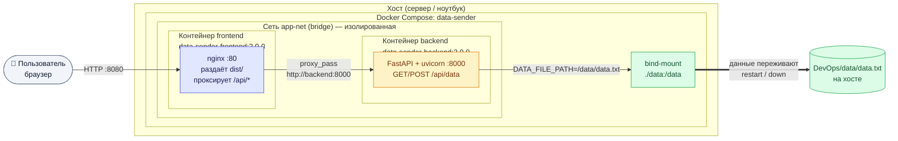

# DevOps — запуск микросервисов через Docker Compose

Репозиторий содержит `docker-compose.yml` для сборки и запуска двух
микросервисов v2.0:

- **backend** — FastAPI-сервер, хранит данные в `data.txt`;
- **frontend** — React-приложение, раздаётся nginx'ом.

## Требования

- Docker Engine 20.10+ (или Docker Desktop)
- Docker Compose v2 (`docker compose version`)

## Структура окружения

Все три репозитория должны лежать рядом:
```bash
projects/
├── backend/
├── frontend/
└── DevOps/
    └── docker-compose.yml
```

## Итоговая структура
```bash
projects/
├── backend/                 # репозиторий lab 1 (v2.0)
│   ├── Dockerfile           ← новый
│   ├── .dockerignore        ← новый
│   ├── server.py            # +1 строка (env для DATA_FILE_PATH)
│   └── requirements.txt
├── frontend/                # репозиторий lab 1 (v2.0)
│   ├── Dockerfile           ← новый
│   ├── .dockerignore        ← новый
│   ├── nginx.conf           ← новый
│   ├── src/config.js        # небольшая правка под prod-режим
│   └── ...
└── DevOps/                  # новый репозиторий
    ├── docker-compose.yml
    ├── .gitignore
    ├── README.md
    └── data/                # сюда монтируется volume (создаётся автоматически)
```

### Архитектура


- Порт `8080` — единственный, опубликованный на хост.
- Бэкенд недоступен снаружи; фронт обращается к нему по имени
  сервиса `http://backend:8000` внутри `app-net`.
- `data.txt` хранится в `./data/` рядом с `docker-compose.yml`.

## Запуск

```bash
cd DevOps
docker compose up -d --build
```

Открыть в браузере: `http://localhost:8080`

## Проверка запуска
```bash
# Статус контейнеров
docker compose ps

# Логи
docker compose logs -f frontend
docker compose logs -f backend

# Файл данных на хосте
ls -l data/
cat data/data.txt
```

Дальше — открыть `http://localhost:8080`, отправить сообщение, нажать
«Прочитать data.txt» — данные должны отобразиться и появиться в
DevOps/data/data.txt.

## Проверка персистентности
```bash
# 1. Отправить сообщение через UI, затем:
docker compose restart backend
# 2. Снова «Прочитать data.txt» — сообщение на месте.

# Или радикальнее:
docker compose down
docker compose up -d
cat data/data.txt   # данные сохранены
```

## Остановка
```bash
docker compose down              # остановить и удалить контейнеры
docker compose down --rmi local  # + удалить собранные образы
```

> `docker compose down` **не удаляет** `./data/` — данные остаются на хосте.